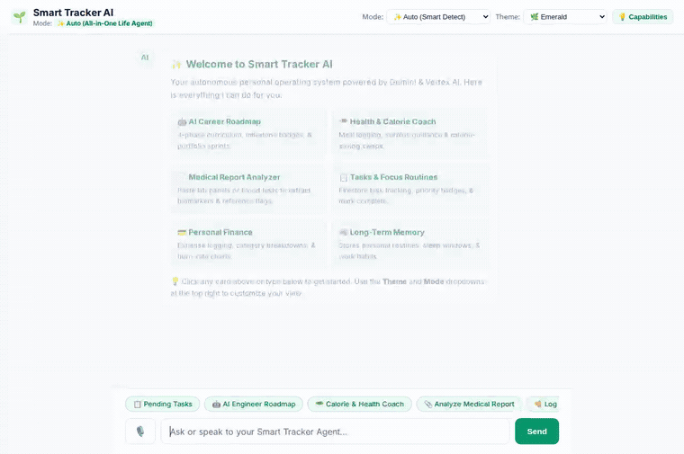

# Smart Tracker AI — Personal Life Agent

> A privacy-conscious, evidence-grounded personal productivity agent powered by **Gemini 3.8 Flash** on Google Cloud Agent Platform.

[](https://smart-tracker-ai-frontend-88951093419.us-central1.run.app)
[](https://github.com/MS1904/buildwithgemini-smart-tracker-ai)

🔗 **Live Public Web App**: [https://smart-tracker-ai-frontend-88951093419.us-central1.run.app](https://smart-tracker-ai-frontend-88951093419.us-central1.run.app)



---

## 🌟 What the Agent Does

Smart Tracker AI acts as a personal life and productivity assistant that helps users manage their focus habits, routines, and daily schedules using **real, verified data**. Rather than acting as a generic conversational bot, it queries persistent preferences and routines stored in Google Cloud to generate realistic, evidence-based recommendations.

### Implemented Capabilities & Tools

The agent code in [`app/agent.py`](app/agent.py) implements and registers the following function tools:

1. **`list_memories(category)`**:
   - Queries Google Cloud **Firestore** for user-approved long-term memories (`preference`, `routine`, `goal_context`, `working_context`).
   - Filters only enabled, user-curated records.
2. **`get_memory(key)`**:
   - Retrieves a specific memory record by key (e.g. `peak_focus_window`).
3. **`save_memory(key, category, content, tags, confidence)`**:
   - Creates or updates a persistent memory record in Firestore with explicit user confidence and timestamps.
4. **`get_weather(query)`**:
   - Contextual weather tool used to adapt exercise routines and outdoor plans.
5. **`get_current_time(query)`**:
   - Timezone-aware clock utility for scheduling daily focus blocks.
6. **A2UI Response Transformation (`a2ui_callback`)**:
   - Built-in callback in [`app/a2ui_utils.py`](app/a2ui_utils.py) that inspects agent turns and packages structured UI components (cards, columns, rows) for rich frontend rendering over the A2A protocol.

---

## ☁️ Google Cloud Services Wired Up

| Service | Component & Role | Status in Code |
| :--- | :--- | :--- |
| **Vertex AI Agent Runtime (Agent Engine)** | Deploys the ADK agent container serving the **A2A (Agent-to-Agent)** JSON-RPC protocol (`agents-cli-manifest.yaml`). | **Implemented & Live** |
| **Gemini 3.8 Flash (`gemini-3.8-flash`)** | Core LLM reasoning engine via Google GenAI on Vertex AI. | **Implemented & Live** |
| **Cloud Firestore (Native Mode)** | Persistent database storing user-approved AI memory documents (`memories` collection). | **Implemented & Live** |
| **Cloud Storage** | Public storage bucket (`gs://smart-tracker-ai-assets-f4cdb9`) configured with `objectViewer` access for public web assets. | **Implemented & Wired** |
| **A2UI v0.8 Specification** | Structured UI callback generating card surfaces over A2A data parts. | **Implemented & Wired** |

> **Planned, Not Yet Implemented in Agent**:
> - *Vertex AI Memory Bank (Agent Platform long-term memory engine)*: Planned as an optional alternative backend to the active Firestore implementation.
> - *Direct on-the-fly Image Generation (Imagen)*: Planned for generating custom badge graphics directly in chat turns.

---

## 🏗️ Architecture

```
┌────────────────────────────────────────┐
│  Smart Tracker Web Frontend            │
│  (Tailored Chat UI + Prompt Chips)     │
└──────────────────┬─────────────────────┘
                   │ HTTP POST (/chat)
┌──────────────────▼─────────────────────┐
│  FastAPI A2A Proxy (frontend/main.py)  │
│  Authenticates with Google ADC         │
└──────────────────┬─────────────────────┘
                   │ A2A Protocol (JSON-RPC 2.0)
┌──────────────────▼─────────────────────┐
│  Agent Runtime (Vertex AI Reasoning)   │
│  - Gemini 3.8 Flash                    │
│  - app/agent.py (Root Agent)           │
└──────────┬──────────────────┬──────────┘
           │                  │
    list/get/save             │
           ▼                  ▼
┌──────────────────┐   ┌──────────────────────────┐
│ Google Cloud     │   │ Google Cloud             │
│ Firestore        │   │ Storage (Assets Bucket)  │
└──────────────────┘   └──────────────────────────┘
```

---

## 🚀 Setup & Local Run Instructions

### Prerequisites
- Python 3.11+
- Google Cloud SDK (`gcloud`) authenticated with your project:
  ```bash
  gcloud auth application-default login
  gcloud config set project <YOUR_PROJECT_ID>
  ```

### 1. Install Dependencies
```bash
pip install -e .
pip install -r frontend/requirements.txt
```

### 2. Seed Firestore Memories (Optional / First Run)
```bash
python seed_firestore.py
```

### 3. Run the Agent Locally with ADK Web
```bash
adk web --port 8080 --allow_origins "*" --reload_agents
```
*(Open the dev UI, disable Token Streaming in settings, and start a conversation).*

### 4. Run the Custom Branded Frontend Proxy
To run the branded Smart Tracker AI chat interface talking to your deployed Agent Runtime:

```bash
export AGENT_ENGINE_RESOURCE_NAME="projects/<PROJECT_NUMBER>/locations/us-central1/reasoningEngines/<REASONING_ENGINE_ID>"
export AGENT_DIRECTORY="app"

cd frontend
python main.py
```
Then navigate to the proxy address in your browser to interact with the agent.

---

## 📄 License
Copyright 2026 Google LLC. Licensed under the Apache License, Version 2.0.
